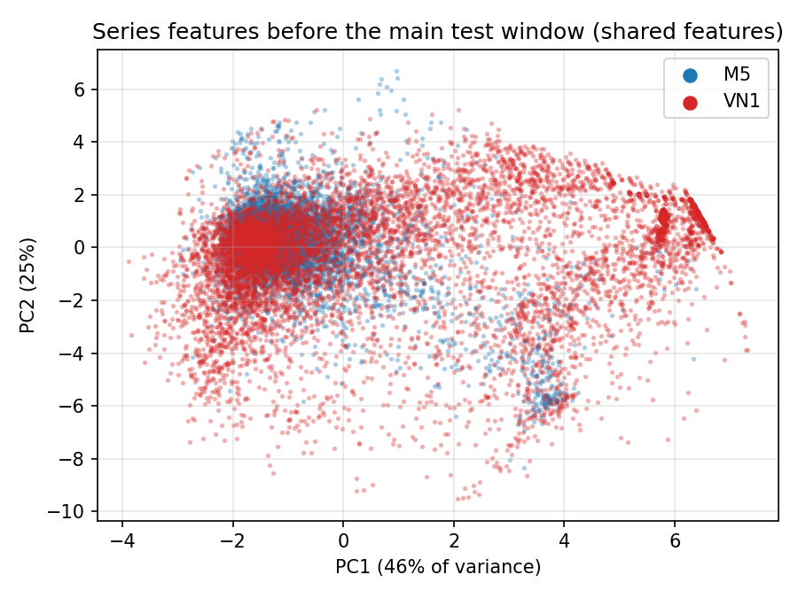

# B2 — Differences between M5 and VN1 (generated by code/dataset_shift.py)

Evaluated series only; every feature is computed from the history before the test period.

## 1. Feature by feature, main window (sorted by KS distance)

KS = Kolmogorov–Smirnov distance (0 = same distribution, 1 = disjoint). PSI > 0.25 is usually read as a large shift. AUC_single = how well the feature alone tells the datasets apart (0.5 = not at all).

| feature         |   M5_median |   M5_q25 |   M5_q75 |   VN1_median |   VN1_q25 |   VN1_q75 |    KS |   PSI |   AUC_single |   M5_missing |   VN1_missing |
|:----------------|------------:|---------:|---------:|-------------:|----------:|----------:|------:|------:|-------------:|-------------:|--------------:|
| hist_len        |     230     |  143     |  251     |      103     |    50     |   160     | 0.679 | 5.475 |        0.842 |        0     |         0     |
| max_share       |       0.022 |    0.015 |    0.035 |        0.1   |     0.048 |     0.218 | 0.615 | 2.841 |        0.883 |        0     |         0     |
| price_cv        |       0.023 |    0     |    0.049 |        0.082 |     0.027 |     0.156 | 0.446 | 1.392 |        0.751 |        0     |         0.003 |
| zero_share      |       0.198 |    0.077 |    0.371 |        0.542 |     0.141 |     0.853 | 0.401 | 1.442 |        0.699 |        0     |         0     |
| adi             |       1.247 |    1.083 |    1.589 |        2.184 |     1.164 |     6.8   | 0.401 | 1.442 |        0.699 |        0     |         0     |
| log_mean        |       1.645 |    1.059 |    2.331 |        0.893 |     0.205 |     2.29  | 0.343 | 1.31  |        0.645 |        0     |         0     |
| since_sale      |       0     |    0     |    0     |        1     |     0     |    15     | 0.331 | 0.704 |        0.693 |        0     |         0     |
| log_size        |       1.841 |    1.326 |    2.482 |        1.391 |     0.869 |     2.59  | 0.264 | 0.765 |        0.604 |        0     |         0     |
| cv2             |       0.315 |    0.24  |    0.408 |        0.342 |     0.124 |     0.633 | 0.229 | 1.087 |        0.516 |        0     |         0     |
| trend_26        |       0.066 |   -0.207 |    0.366 |       -0.038 |    -0.626 |     0.248 | 0.216 | 0.332 |        0.605 |        0.009 |         0.102 |
| recent_ratio_13 |      -0.022 |   -0.373 |    0.258 |       -0.278 |    -0.908 |     0.078 | 0.207 | 0.246 |        0.628 |        0     |         0     |
| peak_ratio_52   |       0.835 |    0.688 |    0.998 |        0.845 |     0.474 |     1.158 | 0.206 | 0.703 |        0.511 |        0.005 |         0.108 |
| acf_52          |       0.035 |   -0.1   |    0.179 |        0.057 |    -0.066 |     0.268 | 0.107 | 0.16  |        0.561 |        0.169 |         0.6   |

## 2. KS distance in the three test windows

| feature         |   main |   w26 |   w52 |
|:----------------|-------:|------:|------:|
| hist_len        |  0.679 | 0.69  | 0.716 |
| max_share       |  0.615 | 0.573 | 0.538 |
| price_cv        |  0.446 | 0.447 | 0.408 |
| zero_share      |  0.401 | 0.371 | 0.349 |
| adi             |  0.401 | 0.371 | 0.349 |
| log_mean        |  0.343 | 0.319 | 0.315 |
| since_sale      |  0.331 | 0.312 | 0.278 |
| log_size        |  0.264 | 0.247 | 0.254 |
| cv2             |  0.229 | 0.228 | 0.248 |
| trend_26        |  0.216 | 0.097 | 0.154 |
| recent_ratio_13 |  0.207 | 0.177 | 0.14  |
| peak_ratio_52   |  0.206 | 0.207 | 0.22  |
| acf_52          |  0.107 | 0.097 | 0.107 |

## 3. Overall separability (classifier “M5 or VN1?”, 5-fold CV, balanced sample)

shared features = log_mean, log_size, adi, cv2, zero_share, since_sale, trend_26, recent_ratio_13, peak_ratio_52 (no history length, no price, no seasonality feature that needs 104 weeks).

| window   |   n_M5 |   n_VN1 |   AUC_all_features |   AUC_shared_features |   AUC_adi_cv2_only |
|:---------|-------:|--------:|-------------------:|----------------------:|-------------------:|
| main     |  30381 |   13844 |              0.994 |                 0.913 |              0.865 |
| w26      |  29917 |   11442 |              0.993 |                 0.908 |              0.866 |
| w52      |  28824 |    9383 |              0.992 |                 0.893 |              0.855 |

## 4. Which shared features carry the difference (permutation importance, main window)

| feature         |   AUC_drop_when_permuted |
|:----------------|-------------------------:|
| adi             |                    0.099 |
| cv2             |                    0.079 |
| trend_26        |                    0.046 |
| log_size        |                    0.034 |
| peak_ratio_52   |                    0.025 |
| recent_ratio_13 |                    0.019 |
| log_mean        |                    0.016 |
| since_sale      |                    0.006 |
| zero_share      |                    0     |

## 5. ADI–CV² class shares, main window

| demand_class   |   M5 |   VN1 |
|:---------------|-----:|------:|
| erratic        |  5.8 |  13.7 |
| intermittent   | 33.9 |  47.2 |
| lumpy          |  7.3 |  20.3 |
| smooth         | 53   |  18.8 |

## 6. PCA of the shared features (main window)

Loadings:

|                 |   PC1 |   PC2 |
|:----------------|------:|------:|
| log_mean        | -0.18 | -0.11 |
| log_size        | -0.14 | -0.13 |
| adi             |  0.6  |  0.26 |
| cv2             | -0.14 | -0.46 |
| zero_share      |  0.2  |  0.07 |
| since_sale      |  0.65 | -0.23 |
| trend_26        | -0.15 |  0.53 |
| recent_ratio_13 | -0.2  |  0.53 |
| peak_ratio_52   | -0.21 | -0.27 |
