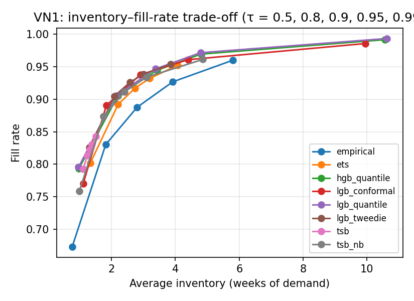

# Cross-dataset results — test window nop (generated by code/analyze_results.py)

## VN1

### Forecast accuracy (all series)

| model         |   horizon |   SQL |   RMSSE |   cov_0.8 |   cov_0.9 |   cov_0.95 |
|:--------------|----------:|------:|--------:|----------:|----------:|-----------:|
| empirical     |         3 | 0.522 |   0.799 |     0.856 |     0.909 |      0.94  |
| empirical     |        13 | 0.557 |   0.636 |     0.806 |     0.855 |      0.875 |
| tsb           |         3 | 0.454 |   0.645 |     0.818 |     0.849 |      0.87  |
| tsb           |        13 | 0.506 |   0.564 |     0.736 |     0.762 |      0.78  |
| tsb_nb        |         3 | 0.411 |   0.65  |     0.843 |     0.903 |      0.934 |
| tsb_nb        |        13 | 0.458 |   0.563 |     0.767 |     0.817 |      0.85  |
| ets           |         3 | 0.431 |   0.654 |     0.876 |     0.912 |      0.931 |
| ets           |        13 | 0.445 |   0.614 |     0.854 |     0.892 |      0.912 |
| lgb_tweedie   |         3 | 0.437 |   0.655 |     0.881 |     0.914 |      0.932 |
| lgb_tweedie   |        13 | 0.632 |   0.989 |     0.904 |     0.925 |      0.937 |
| lgb_conformal |         3 | 0.403 |   0.639 |     0.815 |     0.907 |      0.953 |
| lgb_conformal |        13 | 0.533 |   0.874 |     0.848 |     0.921 |      0.956 |
| hgb_quantile  |         3 | 0.337 |   0.593 |     0.851 |     0.916 |      0.954 |
| hgb_quantile  |        13 | 0.413 |   0.492 |     0.84  |     0.915 |      0.961 |
| lgb_quantile  |         3 | 0.336 |   0.596 |     0.854 |     0.921 |      0.957 |
| lgb_quantile  |        13 | 0.408 |   0.495 |     0.845 |     0.922 |      0.964 |

### SQL by demand class (h = 3)

| model         |   all |   smooth |   erratic |   intermittent |   lumpy |
|:--------------|------:|---------:|----------:|---------------:|--------:|
| empirical     | 0.522 |    0.437 |     0.448 |          0.514 |   0.669 |
| ets           | 0.431 |    0.319 |     0.35  |          0.474 |   0.49  |
| hgb_quantile  | 0.337 |    0.262 |     0.26  |          0.385 |   0.348 |
| lgb_conformal | 0.403 |    0.282 |     0.296 |          0.473 |   0.425 |
| lgb_quantile  | 0.336 |    0.262 |     0.258 |          0.385 |   0.344 |
| lgb_tweedie   | 0.437 |    0.293 |     0.32  |          0.51  |   0.477 |
| tsb           | 0.454 |    0.376 |     0.428 |          0.459 |   0.533 |
| tsb_nb        | 0.411 |    0.314 |     0.353 |          0.443 |   0.465 |

### Inventory KPIs, default scenario, no liquidation (all series)

| model         |   fill_rate |   stockout_rate_demand_weeks |   inventory_weeks |   excess_weeks_of_demand |   fill_rate_lo |   fill_rate_hi |   inventory_weeks_lo |   inventory_weeks_hi |
|:--------------|------------:|-----------------------------:|------------------:|-------------------------:|---------------:|---------------:|---------------------:|---------------------:|
| empirical     |       0.888 |                        0.137 |             2.802 |                    0.743 |          0.877 |          0.898 |                2.589 |                2.996 |
| tsb           |       0.823 |                        0.216 |             1.313 |                    0.25  |          0.813 |          0.832 |                1.183 |                1.447 |
| tsb_nb        |       0.911 |                        0.125 |             2.401 |                    0.429 |          0.902 |          0.92  |                2.224 |                2.6   |
| ets           |       0.917 |                        0.1   |             2.738 |                    0.656 |          0.908 |          0.925 |                2.529 |                2.966 |
| lgb_tweedie   |       0.926 |                        0.092 |             2.583 |                    0.532 |          0.919 |          0.933 |                2.391 |                2.773 |
| lgb_conformal |       0.938 |                        0.083 |             2.902 |                    0.541 |          0.929 |          0.946 |                2.699 |                3.116 |
| hgb_quantile  |       0.944 |                        0.07  |             3.425 |                    0.952 |          0.939 |          0.95  |                3.13  |                3.747 |
| lgb_quantile  |       0.947 |                        0.066 |             3.38  |                    0.908 |          0.941 |          0.952 |                3.094 |                3.674 |

### fill_rate by demand class (default, no liquidation)

| model         |   all |   smooth |   erratic |   intermittent |   lumpy |
|:--------------|------:|---------:|----------:|---------------:|--------:|
| empirical     | 0.888 |    0.926 |     0.858 |          0.852 |   0.72  |
| ets           | 0.917 |    0.942 |     0.884 |          0.913 |   0.844 |
| hgb_quantile  | 0.944 |    0.958 |     0.92  |          0.947 |   0.927 |
| lgb_conformal | 0.938 |    0.96  |     0.895 |          0.947 |   0.906 |
| lgb_quantile  | 0.947 |    0.959 |     0.923 |          0.949 |   0.927 |
| lgb_tweedie   | 0.926 |    0.949 |     0.894 |          0.924 |   0.862 |
| tsb           | 0.823 |    0.867 |     0.753 |          0.844 |   0.708 |
| tsb_nb        | 0.911 |    0.941 |     0.869 |          0.911 |   0.828 |

### inventory_weeks by demand class (default, no liquidation)

| model         |   all |   smooth |   erratic |   intermittent |   lumpy |
|:--------------|------:|---------:|----------:|---------------:|--------:|
| empirical     | 2.802 |    2.109 |     3.653 |          3.456 |   4.691 |
| ets           | 2.738 |    1.77  |     3.876 |          2.889 |   6.171 |
| hgb_quantile  | 3.425 |    2.308 |     4.537 |          3.911 |   7.836 |
| lgb_conformal | 2.902 |    2.162 |     3.383 |          4.191 |   5.945 |
| lgb_quantile  | 3.38  |    2.329 |     4.393 |          3.943 |   7.565 |
| lgb_tweedie   | 2.583 |    1.888 |     3.315 |          3.042 |   5.053 |
| tsb           | 1.313 |    0.931 |     1.707 |          1.436 |   2.817 |
| tsb_nb        | 2.401 |    1.688 |     3.268 |          2.323 |   4.982 |

### Trade-off: fill rate and inventory (weeks) across target service level τ

| model         |   ('fill_rate', 0.5) |   ('fill_rate', 0.8) |   ('fill_rate', 0.9) |   ('fill_rate', 0.95) |   ('fill_rate', 0.99) |   ('inventory_weeks', 0.5) |   ('inventory_weeks', 0.8) |   ('inventory_weeks', 0.9) |   ('inventory_weeks', 0.95) |   ('inventory_weeks', 0.99) |
|:--------------|---------------------:|---------------------:|---------------------:|----------------------:|----------------------:|---------------------------:|---------------------------:|---------------------------:|----------------------------:|----------------------------:|
| empirical     |                0.673 |                0.83  |                0.888 |                 0.927 |                 0.96  |                      0.77  |                      1.82  |                      2.802 |                       3.915 |                       5.794 |
| ets           |                0.802 |                0.892 |                0.917 |                 0.932 |                 0.952 |                      1.335 |                      2.208 |                      2.738 |                       3.194 |                       4.069 |
| hgb_quantile  |                0.794 |                0.905 |                0.944 |                 0.969 |                 0.991 |                      0.98  |                      2.198 |                      3.425 |                       4.804 |                      10.564 |
| lgb_conformal |                0.771 |                0.89  |                0.938 |                 0.961 |                 0.986 |                      1.116 |                      1.838 |                      2.902 |                       4.398 |                       9.951 |
| lgb_quantile  |                0.795 |                0.905 |                0.947 |                 0.971 |                 0.993 |                      0.967 |                      2.139 |                      3.38  |                       4.789 |                      10.627 |
| lgb_tweedie   |                0.826 |                0.905 |                0.926 |                 0.939 |                 0.954 |                      1.307 |                      2.093 |                      2.583 |                       3.01  |                       3.859 |
| tsb           |                0.793 |                0.813 |                0.823 |                 0.83  |                 0.843 |                      1.114 |                      1.24  |                      1.313 |                       1.378 |                       1.508 |
| tsb_nb        |                0.759 |                0.874 |                0.911 |                 0.934 |                 0.961 |                      0.995 |                      1.751 |                      2.401 |                       3.091 |                       4.858 |

### Inventory (weeks of demand) needed to reach a fill rate — all (— = outside the fill range reached for τ ∈ [0.5, 0.99])

|               |   fill 0.90 |   fill 0.92 |   fill 0.94 |   fill 0.96 |   fill 0.98 |
|:--------------|------------:|------------:|------------:|------------:|------------:|
| empirical     |        3.16 |        3.73 |        4.67 |      —    |      —    |
| ets           |        2.38 |        2.83 |        3.54 |      —    |      —    |
| hgb_quantile  |        2.14 |        2.66 |        3.29 |        4.29 |        7.58 |
| lgb_conformal |        2.05 |        2.5  |        3.05 |        4.35 |        8.71 |
| lgb_quantile  |        2.08 |        2.58 |        3.18 |        4.14 |        7.07 |
| lgb_tweedie   |        2.05 |        2.44 |        3.08 |      —    |      —    |
| tsb           |      —    |      —    |      —    |      —    |      —    |
| tsb_nb        |        2.21 |        2.67 |        3.5  |        4.79 |      —    |

### Inventory (weeks of demand) needed to reach a fill rate — smooth (— = outside the fill range reached for τ ∈ [0.5, 0.99])

|               |   fill 0.90 |   fill 0.92 |   fill 0.94 |   fill 0.96 |   fill 0.98 |
|:--------------|------------:|------------:|------------:|------------:|------------:|
| empirical     |        1.7  |        2.02 |        2.43 |        3.12 |      —    |
| ets           |        1.28 |        1.42 |        1.74 |        2.34 |      —    |
| hgb_quantile  |        1.31 |        1.48 |        1.9  |        2.42 |        3.77 |
| lgb_conformal |        1.31 |        1.42 |        1.74 |        2.16 |        3.6  |
| lgb_quantile  |        1.32 |        1.49 |        1.88 |        2.36 |        3.48 |
| lgb_tweedie   |        1.28 |        1.43 |        1.71 |        2.24 |      —    |
| tsb           |      —    |      —    |      —    |      —    |      —    |
| tsb_nb        |        1.19 |        1.36 |        1.67 |        2.32 |      —    |

### Inventory (weeks of demand) needed to reach a fill rate — erratic (— = outside the fill range reached for τ ∈ [0.5, 0.99])

|               |   fill 0.90 |   fill 0.92 |   fill 0.94 |   fill 0.96 |   fill 0.98 |
|:--------------|------------:|------------:|------------:|------------:|------------:|
| empirical     |        5.07 |        6.04 |        7.39 |      —    |      —    |
| ets           |        4.39 |        5.19 |      —    |      —    |      —    |
| hgb_quantile  |        3.85 |        4.56 |        5.62 |        7.62 |       12.62 |
| lgb_conformal |        3.63 |        4.56 |        6.36 |        8.83 |      —    |
| lgb_quantile  |        3.64 |        4.3  |        5.34 |        6.72 |       11.39 |
| lgb_tweedie   |        3.5  |        4.37 |      —    |      —    |      —    |
| tsb           |      —    |      —    |      —    |      —    |      —    |
| tsb_nb        |        4.22 |        5.45 |        6.79 |      —    |      —    |

### Inventory (weeks of demand) needed to reach a fill rate — intermittent (— = outside the fill range reached for τ ∈ [0.5, 0.99])

|               |   fill 0.90 |   fill 0.92 |   fill 0.94 |   fill 0.96 |   fill 0.98 |
|:--------------|------------:|------------:|------------:|------------:|------------:|
| empirical     |        4.47 |        5.19 |      —    |      —    |      —    |
| ets           |        2.59 |        3.13 |        4.01 |      —    |      —    |
| hgb_quantile  |        2.59 |        3.07 |        3.68 |        4.83 |       10.61 |
| lgb_conformal |        3.36 |        3.71 |        4.06 |        6.41 |       16.26 |
| lgb_quantile  |        2.46 |        2.94 |        3.62 |        4.72 |       10.13 |
| lgb_tweedie   |        2.52 |        2.95 |        3.72 |      —    |      —    |
| tsb           |      —    |      —    |      —    |      —    |      —    |
| tsb_nb        |        2.12 |        2.64 |        3.68 |      —    |      —    |

### Inventory (weeks of demand) needed to reach a fill rate — lumpy (— = outside the fill range reached for τ ∈ [0.5, 0.99])

|               |   fill 0.90 |   fill 0.92 |   fill 0.94 |   fill 0.96 |   fill 0.98 |
|:--------------|------------:|------------:|------------:|------------:|------------:|
| empirical     |       12.8  |      —    |      —    |      —    |      —    |
| ets           |      —    |      —    |      —    |      —    |      —    |
| hgb_quantile  |        6.27 |        7.44 |        9.14 |       12.54 |       20.94 |
| lgb_conformal |        5.77 |        7.48 |        9.67 |       19.12 |       31.93 |
| lgb_quantile  |        6.08 |        7.17 |        8.7  |       11.28 |       20.07 |
| lgb_tweedie   |      —    |      —    |      —    |      —    |      —    |
| tsb           |      —    |      —    |      —    |      —    |      —    |
| tsb_nb        |        8.99 |       10.76 |      —    |      —    |      —    |

### Frontier rank (mean rank of inventory needed over the fill targets; 1 = least inventory; a model that cannot reach a target shares the last ranks)

|               |   all |   smooth |   erratic |   intermittent |   lumpy |
|:--------------|------:|---------:|----------:|---------------:|--------:|
| empirical     |   6.7 |      6.8 |       6.1 |            6.7 |     5.9 |
| ets           |   6.1 |      3.8 |       5.9 |            5.2 |     6.3 |
| hgb_quantile  |   3.2 |      5   |       2.6 |            3   |     2.2 |
| lgb_conformal |   2.2 |      2.6 |       3.5 |            4.8 |     2.6 |
| lgb_quantile  |   2.2 |      4.6 |       1.4 |            1.4 |     1.2 |
| lgb_tweedie   |   3.3 |      3.2 |       4.3 |            4.4 |     6.3 |
| tsb           |   7.3 |      7.6 |       6.9 |            7.1 |     6.3 |
| tsb_nb        |   5   |      2.4 |       5.3 |            3.4 |     5.2 |

### Liquidation policies, default scenario (all series)

| model         | policy   |   fill_rate |   stockout_rate_demand_weeks |   inventory_weeks |   excess_weeks_of_demand |   liquidated_share |   liq_series_share |
|:--------------|:---------|------------:|-----------------------------:|------------------:|-------------------------:|-------------------:|-------------------:|
| empirical     | none     |      0.8876 |                       0.1367 |            2.8016 |                   0.7432 |             0      |             0      |
| empirical     | quantile |      0.8876 |                       0.1367 |            2.7934 |                   0.7403 |             0.001  |             0.0158 |
| empirical     | fixed    |      0.8856 |                       0.148  |            2.4632 |                   0.4826 |             0.0794 |             0.2748 |
| empirical     | dead13   |      0.8865 |                       0.1511 |            2.5168 |                   0.518  |             0.0117 |             0.1788 |
| empirical     | dead26   |      0.8873 |                       0.1419 |            2.6413 |                   0.6208 |             0.0066 |             0.0933 |
| tsb           | none     |      0.823  |                       0.2163 |            1.3135 |                   0.2499 |             0      |             0      |
| tsb           | quantile |      0.8134 |                       0.2224 |            1.1042 |                   0.2298 |             0.0267 |             0.2183 |
| tsb           | fixed    |      0.8229 |                       0.2192 |            1.3018 |                   0.2468 |             0.0024 |             0.1599 |
| tsb           | dead13   |      0.8225 |                       0.2251 |            1.2719 |                   0.2404 |             0.0053 |             0.1913 |
| tsb           | dead26   |      0.823  |                       0.2176 |            1.3093 |                   0.249  |             0.0006 |             0.074  |
| tsb_nb        | none     |      0.9112 |                       0.125  |            2.4011 |                   0.4294 |             0      |             0      |
| tsb_nb        | quantile |      0.9067 |                       0.1296 |            2.2462 |                   0.412  |             0.0228 |             0.177  |
| tsb_nb        | fixed    |      0.9107 |                       0.1288 |            2.3704 |                   0.4197 |             0.0054 |             0.1687 |
| tsb_nb        | dead13   |      0.9106 |                       0.1335 |            2.3392 |                   0.4152 |             0.0078 |             0.1841 |
| tsb_nb        | dead26   |      0.9112 |                       0.1261 |            2.3961 |                   0.4289 |             0.001  |             0.0615 |
| ets           | none     |      0.917  |                       0.1002 |            2.7381 |                   0.6562 |             0      |             0      |
| ets           | quantile |      0.9167 |                       0.1004 |            2.7245 |                   0.6505 |             0.0012 |             0.0198 |
| ets           | fixed    |      0.9155 |                       0.1119 |            2.5377 |                   0.5012 |             0.0544 |             0.4242 |
| ets           | dead13   |      0.916  |                       0.1163 |            2.5329 |                   0.5065 |             0.0106 |             0.1927 |
| ets           | dead26   |      0.9168 |                       0.1067 |            2.6337 |                   0.5744 |             0.0042 |             0.1112 |
| lgb_tweedie   | none     |      0.9262 |                       0.0916 |            2.5825 |                   0.5317 |             0      |             0      |
| lgb_tweedie   | quantile |      0.926  |                       0.0917 |            2.5602 |                   0.5184 |             0.002  |             0.0145 |
| lgb_tweedie   | fixed    |      0.9238 |                       0.1007 |            2.4916 |                   0.4888 |             0.0183 |             0.4459 |
| lgb_tweedie   | dead13   |      0.9252 |                       0.1073 |            2.4541 |                   0.4636 |             0.0102 |             0.196  |
| lgb_tweedie   | dead26   |      0.926  |                       0.0971 |            2.541  |                   0.5098 |             0.003  |             0.1119 |
| lgb_conformal | none     |      0.9377 |                       0.0833 |            2.9024 |                   0.5405 |             0      |             0      |
| lgb_conformal | quantile |      0.9375 |                       0.0835 |            2.8822 |                   0.5348 |             0.002  |             0.026  |
| lgb_conformal | fixed    |      0.9346 |                       0.0931 |            2.7898 |                   0.4712 |             0.0209 |             0.4343 |
| lgb_conformal | dead13   |      0.9366 |                       0.099  |            2.7602 |                   0.4562 |             0.0092 |             0.196  |
| lgb_conformal | dead26   |      0.9374 |                       0.0891 |            2.8411 |                   0.5005 |             0.0032 |             0.1115 |
| hgb_quantile  | none     |      0.9445 |                       0.07   |            3.4249 |                   0.9521 |             0      |             0      |
| hgb_quantile  | quantile |      0.9438 |                       0.0704 |            3.0794 |                   0.8596 |             0.0324 |             0.0826 |
| hgb_quantile  | fixed    |      0.9377 |                       0.0835 |            3.2095 |                   0.8248 |             0.0294 |             0.5092 |
| hgb_quantile  | dead13   |      0.9436 |                       0.0852 |            3.2985 |                   0.9026 |             0.0124 |             0.1942 |
| hgb_quantile  | dead26   |      0.9443 |                       0.0752 |            3.3922 |                   0.9321 |             0.002  |             0.1116 |
| lgb_quantile  | none     |      0.9466 |                       0.0659 |            3.3804 |                   0.9076 |             0      |             0      |
| lgb_quantile  | quantile |      0.9463 |                       0.0661 |            3.2287 |                   0.845  |             0.0135 |             0.0545 |
| lgb_quantile  | fixed    |      0.9398 |                       0.0794 |            3.1681 |                   0.7851 |             0.0282 |             0.5086 |
| lgb_quantile  | dead13   |      0.9456 |                       0.0811 |            3.2521 |                   0.8558 |             0.0123 |             0.1932 |
| lgb_quantile  | dead26   |      0.9463 |                       0.0711 |            3.345  |                   0.8856 |             0.0021 |             0.1115 |
