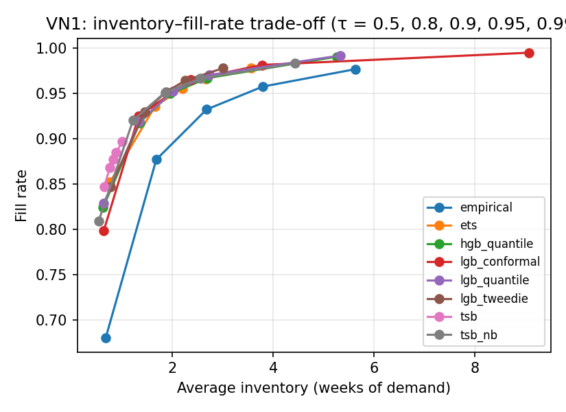

# Cross-dataset results — test window w26_nop (generated by code/analyze_results.py)

## VN1

### Forecast accuracy (all series)

| model         |   horizon |   SQL |   RMSSE |   cov_0.8 |   cov_0.9 |   cov_0.95 |
|:--------------|----------:|------:|--------:|----------:|----------:|-----------:|
| empirical     |         3 | 0.966 |   1.037 |     0.854 |     0.91  |      0.94  |
| empirical     |        13 | 1.187 |   0.855 |     0.799 |     0.85  |      0.872 |
| tsb           |         3 | 0.812 |   0.751 |     0.811 |     0.848 |      0.872 |
| tsb           |        13 | 1.039 |   0.638 |     0.72  |     0.751 |      0.774 |
| tsb_nb        |         3 | 0.757 |   0.76  |     0.838 |     0.904 |      0.937 |
| tsb_nb        |        13 | 0.994 |   0.638 |     0.759 |     0.816 |      0.851 |
| ets           |         3 | 0.683 |   0.724 |     0.875 |     0.914 |      0.934 |
| ets           |        13 | 0.919 |   0.651 |     0.852 |     0.891 |      0.912 |
| lgb_tweedie   |         3 | 0.632 |   0.706 |     0.867 |     0.905 |      0.927 |
| lgb_tweedie   |        13 | 0.951 |   0.691 |     0.874 |     0.909 |      0.928 |
| lgb_conformal |         3 | 0.615 |   0.697 |     0.811 |     0.907 |      0.953 |
| lgb_conformal |        13 | 0.964 |   0.663 |     0.821 |     0.92  |      0.963 |
| hgb_quantile  |         3 | 0.548 |   0.692 |     0.839 |     0.908 |      0.947 |
| hgb_quantile  |        13 | 0.791 |   0.606 |     0.814 |     0.896 |      0.944 |
| lgb_quantile  |         3 | 0.54  |   0.683 |     0.839 |     0.911 |      0.95  |
| lgb_quantile  |        13 | 0.781 |   0.6   |     0.814 |     0.903 |      0.948 |

### SQL by demand class (h = 3)

| model         |   all |   smooth |   erratic |   intermittent |   lumpy |
|:--------------|------:|---------:|----------:|---------------:|--------:|
| empirical     | 0.966 |    0.429 |     0.367 |          1.559 |   0.56  |
| ets           | 0.683 |    0.257 |     0.254 |          1.13  |   0.382 |
| hgb_quantile  | 0.548 |    0.232 |     0.207 |          0.91  |   0.27  |
| lgb_conformal | 0.615 |    0.245 |     0.227 |          1.022 |   0.324 |
| lgb_quantile  | 0.54  |    0.231 |     0.206 |          0.897 |   0.264 |
| lgb_tweedie   | 0.632 |    0.252 |     0.233 |          1.06  |   0.309 |
| tsb           | 0.812 |    0.297 |     0.281 |          1.381 |   0.393 |
| tsb_nb        | 0.757 |    0.25  |     0.248 |          1.316 |   0.339 |

### Inventory KPIs, default scenario, no liquidation (all series)

| model         |   fill_rate |   stockout_rate_demand_weeks |   inventory_weeks |   excess_weeks_of_demand |   fill_rate_lo |   fill_rate_hi |   inventory_weeks_lo |   inventory_weeks_hi |
|:--------------|------------:|-----------------------------:|------------------:|-------------------------:|---------------:|---------------:|---------------------:|---------------------:|
| empirical     |       0.932 |                        0.118 |             2.681 |                    0.713 |          0.925 |          0.939 |                2.441 |                2.919 |
| tsb           |       0.878 |                        0.191 |             0.827 |                    0.099 |          0.87  |          0.884 |                0.773 |                0.885 |
| tsb_nb        |       0.951 |                        0.105 |             1.856 |                    0.2   |          0.945 |          0.955 |                1.75  |                1.967 |
| ets           |       0.955 |                        0.079 |             2.198 |                    0.441 |          0.95  |          0.959 |                2.021 |                2.361 |
| lgb_tweedie   |       0.952 |                        0.082 |             1.881 |                    0.296 |          0.947 |          0.955 |                1.758 |                2.019 |
| lgb_conformal |       0.965 |                        0.07  |             2.362 |                    0.295 |          0.96  |          0.969 |                2.23  |                2.501 |
| hgb_quantile  |       0.95  |                        0.072 |             1.961 |                    0.296 |          0.944 |          0.954 |                1.838 |                2.096 |
| lgb_quantile  |       0.952 |                        0.069 |             2.018 |                    0.305 |          0.947 |          0.956 |                1.88  |                2.158 |

### fill_rate by demand class (default, no liquidation)

| model         |   all |   smooth |   erratic |   intermittent |   lumpy |
|:--------------|------:|---------:|----------:|---------------:|--------:|
| empirical     | 0.932 |    0.953 |     0.924 |          0.859 |   0.874 |
| ets           | 0.955 |    0.964 |     0.951 |          0.925 |   0.939 |
| hgb_quantile  | 0.95  |    0.957 |     0.936 |          0.943 |   0.951 |
| lgb_conformal | 0.965 |    0.973 |     0.951 |          0.952 |   0.961 |
| lgb_quantile  | 0.952 |    0.959 |     0.937 |          0.946 |   0.956 |
| lgb_tweedie   | 0.952 |    0.957 |     0.946 |          0.935 |   0.944 |
| tsb           | 0.878 |    0.893 |     0.86  |          0.853 |   0.849 |
| tsb_nb        | 0.951 |    0.96  |     0.943 |          0.913 |   0.942 |

### inventory_weeks by demand class (default, no liquidation)

| model         |   all |   smooth |   erratic |   intermittent |   lumpy |
|:--------------|------:|---------:|----------:|---------------:|--------:|
| empirical     | 2.681 |    2.045 |     3.562 |          2.996 |   3.928 |
| ets           | 2.198 |    1.453 |     3.26  |          2.288 |   3.765 |
| hgb_quantile  | 1.961 |    1.395 |     2.543 |          2.657 |   3.38  |
| lgb_conformal | 2.362 |    1.716 |     2.891 |          3.41  |   4.209 |
| lgb_quantile  | 2.018 |    1.431 |     2.598 |          2.69  |   3.59  |
| lgb_tweedie   | 1.881 |    1.37  |     2.465 |          2.33  |   3.106 |
| tsb           | 0.827 |    0.629 |     1.027 |          1.165 |   1.274 |
| tsb_nb        | 1.856 |    1.344 |     2.591 |          1.926 |   2.917 |

### Trade-off: fill rate and inventory (weeks) across target service level τ

| model         |   ('fill_rate', 0.5) |   ('fill_rate', 0.8) |   ('fill_rate', 0.9) |   ('fill_rate', 0.95) |   ('fill_rate', 0.99) |   ('inventory_weeks', 0.5) |   ('inventory_weeks', 0.8) |   ('inventory_weeks', 0.9) |   ('inventory_weeks', 0.95) |   ('inventory_weeks', 0.99) |
|:--------------|---------------------:|---------------------:|---------------------:|----------------------:|----------------------:|---------------------------:|---------------------------:|---------------------------:|----------------------------:|----------------------------:|
| empirical     |                0.681 |                0.877 |                0.932 |                 0.957 |                 0.977 |                      0.681 |                      1.683 |                      2.681 |                       3.793 |                       5.636 |
| ets           |                0.852 |                0.935 |                0.955 |                 0.966 |                 0.978 |                      0.767 |                      1.656 |                      2.198 |                       2.665 |                       3.566 |
| hgb_quantile  |                0.824 |                0.918 |                0.95  |                 0.967 |                 0.99  |                      0.628 |                      1.354 |                      1.961 |                       2.696 |                       5.262 |
| lgb_conformal |                0.798 |                0.925 |                0.965 |                 0.981 |                 0.995 |                      0.641 |                      1.333 |                      2.362 |                       3.78  |                       9.074 |
| lgb_quantile  |                0.829 |                0.918 |                0.952 |                 0.97  |                 0.992 |                      0.639 |                      1.344 |                      2.018 |                       2.731 |                       5.328 |
| lgb_tweedie   |                0.847 |                0.929 |                0.952 |                 0.964 |                 0.977 |                      0.779 |                      1.452 |                      1.881 |                       2.258 |                       3.001 |
| tsb           |                0.847 |                0.868 |                0.878 |                 0.885 |                 0.897 |                      0.649 |                      0.761 |                      0.827 |                       0.887 |                       1.007 |
| tsb_nb        |                0.81  |                0.92  |                0.951 |                 0.966 |                 0.983 |                      0.542 |                      1.223 |                      1.856 |                       2.557 |                       4.435 |

### Inventory (weeks of demand) needed to reach a fill rate — all (— = outside the fill range reached for τ ∈ [0.5, 0.99])

|               |   fill 0.90 |   fill 0.92 |   fill 0.94 |   fill 0.96 |   fill 0.98 |
|:--------------|------------:|------------:|------------:|------------:|------------:|
| empirical     |        2.1  |        2.46 |        3.03 |        4.05 |      —    |
| ets           |        1.28 |        1.49 |        1.78 |        2.4  |      —    |
| hgb_quantile  |        1.22 |        1.4  |        1.78 |        2.41 |        4.14 |
| lgb_conformal |        1.2  |        1.31 |        1.73 |        2.24 |        3.67 |
| lgb_quantile  |        1.2  |        1.37 |        1.77 |        2.33 |        3.93 |
| lgb_tweedie   |        1.21 |        1.37 |        1.66 |        2.13 |      —    |
| tsb           |      —    |      —    |      —    |      —    |      —    |
| tsb_nb        |        1.1  |        1.22 |        1.63 |        2.27 |        4.1  |

### Inventory (weeks of demand) needed to reach a fill rate — smooth (— = outside the fill range reached for τ ∈ [0.5, 0.99])

|               |   fill 0.90 |   fill 0.92 |   fill 0.94 |   fill 0.96 |   fill 0.98 |
|:--------------|------------:|------------:|------------:|------------:|------------:|
| empirical     |        1.33 |        1.47 |        1.82 |        2.29 |        3.31 |
| ets           |        0.8  |        0.94 |        1.08 |        1.39 |        2.14 |
| hgb_quantile  |        0.83 |        0.94 |        1.17 |        1.5  |        2.48 |
| lgb_conformal |        0.86 |        0.97 |        1.08 |        1.43 |        2.07 |
| lgb_quantile  |        0.82 |        0.94 |        1.16 |        1.45 |        2.23 |
| lgb_tweedie   |        0.81 |        0.94 |        1.1  |        1.44 |        2.14 |
| tsb           |        0.67 |      —    |      —    |      —    |      —    |
| tsb_nb        |        0.75 |        0.86 |        1.02 |        1.34 |        2.17 |

### Inventory (weeks of demand) needed to reach a fill rate — erratic (— = outside the fill range reached for τ ∈ [0.5, 0.99])

|               |   fill 0.90 |   fill 0.92 |   fill 0.94 |   fill 0.96 |   fill 0.98 |
|:--------------|------------:|------------:|------------:|------------:|------------:|
| empirical     |        3.03 |        3.47 |        4.51 |        5.91 |      —    |
| ets           |        1.95 |        2.26 |        2.82 |        3.88 |      —    |
| hgb_quantile  |        1.69 |        2.15 |        2.79 |        4.24 |        6.42 |
| lgb_conformal |        1.6  |        1.93 |        2.56 |        3.66 |        6.75 |
| lgb_quantile  |        1.68 |        2.16 |        2.75 |        4.01 |        6.37 |
| lgb_tweedie   |        1.67 |        1.88 |        2.32 |        3    |      —    |
| tsb           |      —    |      —    |      —    |      —    |      —    |
| tsb_nb        |        1.59 |        2.02 |        2.51 |        3.64 |        6.79 |

### Inventory (weeks of demand) needed to reach a fill rate — intermittent (— = outside the fill range reached for τ ∈ [0.5, 0.99])

|               |   fill 0.90 |   fill 0.92 |   fill 0.94 |   fill 0.96 |   fill 0.98 |
|:--------------|------------:|------------:|------------:|------------:|------------:|
| empirical     |        3.68 |        4.2  |        4.8  |      —    |      —    |
| ets           |        1.76 |        2.18 |        2.87 |      —    |      —    |
| hgb_quantile  |        1.73 |        2.04 |        2.57 |        3.63 |        7.17 |
| lgb_conformal |        2.27 |        2.7  |        3.14 |        4.7  |       14.12 |
| lgb_quantile  |        1.68 |        2    |        2.53 |        3.51 |        6.72 |
| lgb_tweedie   |        1.75 |        2.02 |        2.51 |      —    |      —    |
| tsb           |      —    |      —    |      —    |      —    |      —    |
| tsb_nb        |        1.68 |        2.16 |        3.11 |      —    |      —    |

### Inventory (weeks of demand) needed to reach a fill rate — lumpy (— = outside the fill range reached for τ ∈ [0.5, 0.99])

|               |   fill 0.90 |   fill 0.92 |   fill 0.94 |   fill 0.96 |   fill 0.98 |
|:--------------|------------:|------------:|------------:|------------:|------------:|
| empirical     |        5.14 |        6.07 |        7.85 |       10.02 |      —    |
| ets           |        2.52 |        2.94 |        3.87 |        5.57 |      —    |
| hgb_quantile  |        2.22 |        2.52 |        3.07 |        3.98 |        6.83 |
| lgb_conformal |        2.33 |        2.95 |        3.56 |        4.18 |        7.66 |
| lgb_quantile  |        2.13 |        2.45 |        3.09 |        3.9  |        6.32 |
| lgb_tweedie   |        2.26 |        2.53 |        3.01 |        3.86 |      —    |
| tsb           |      —    |      —    |      —    |      —    |      —    |
| tsb_nb        |        1.75 |        2.29 |        2.87 |        4.15 |        8.24 |

### Frontier rank (mean rank of inventory needed over the fill targets; 1 = least inventory; a model that cannot reach a target shares the last ranks)

|               |   all |   smooth |   erratic |   intermittent |   lumpy |
|:--------------|------:|---------:|----------:|---------------:|--------:|
| empirical     |   6.9 |      7.2 |       6.9 |            6.6 |     6.9 |
| ets           |   5.9 |      2.4 |       5.7 |            5.2 |     5.9 |
| hgb_quantile  |   5   |      5.8 |       4.4 |            2.6 |     2.8 |
| lgb_conformal |   2   |      4   |       2.6 |            4.8 |     4.8 |
| lgb_quantile  |   3.2 |      4.6 |       3.8 |            1.2 |     2.2 |
| lgb_tweedie   |   3.5 |      3.6 |       2.5 |            3.8 |     3.5 |
| tsb           |   7.7 |      6.6 |       7.7 |            7.2 |     7.7 |
| tsb_nb        |   1.8 |      1.8 |       2.4 |            4.6 |     2.2 |

### Liquidation policies, default scenario (all series)

| model         | policy   |   fill_rate |   stockout_rate_demand_weeks |   inventory_weeks |   excess_weeks_of_demand |   liquidated_share |   liq_series_share |
|:--------------|:---------|------------:|-----------------------------:|------------------:|-------------------------:|-------------------:|-------------------:|
| empirical     | none     |      0.9322 |                       0.1178 |            2.6813 |                   0.7134 |             0      |             0      |
| empirical     | quantile |      0.9322 |                       0.1178 |            2.679  |                   0.713  |             0.0003 |             0.0104 |
| empirical     | fixed    |      0.931  |                       0.1304 |            2.3197 |                   0.4628 |             0.0884 |             0.2674 |
| empirical     | dead13   |      0.9312 |                       0.1327 |            2.4058 |                   0.4726 |             0.0119 |             0.1553 |
| empirical     | dead26   |      0.9318 |                       0.1235 |            2.5249 |                   0.5944 |             0.0063 |             0.0892 |
| tsb           | none     |      0.8776 |                       0.1906 |            0.8274 |                   0.0992 |             0      |             0      |
| tsb           | quantile |      0.8767 |                       0.1961 |            0.7659 |                   0.0807 |             0.0069 |             0.1824 |
| tsb           | fixed    |      0.8773 |                       0.1946 |            0.8115 |                   0.0937 |             0.0028 |             0.1546 |
| tsb           | dead13   |      0.8771 |                       0.1996 |            0.7983 |                   0.0914 |             0.0037 |             0.1606 |
| tsb           | dead26   |      0.8775 |                       0.1922 |            0.824  |                   0.0984 |             0.0005 |             0.0684 |
| tsb_nb        | none     |      0.9509 |                       0.1053 |            1.8562 |                   0.1999 |             0      |             0      |
| tsb_nb        | quantile |      0.9503 |                       0.1102 |            1.7865 |                   0.1821 |             0.0079 |             0.1476 |
| tsb_nb        | fixed    |      0.9505 |                       0.1098 |            1.8155 |                   0.1846 |             0.0063 |             0.1585 |
| tsb_nb        | dead13   |      0.9504 |                       0.1135 |            1.8141 |                   0.1905 |             0.0055 |             0.1533 |
| tsb_nb        | dead26   |      0.9509 |                       0.1064 |            1.8526 |                   0.1995 |             0.0006 |             0.0572 |
| ets           | none     |      0.9554 |                       0.0793 |            2.198  |                   0.4405 |             0      |             0      |
| ets           | quantile |      0.9554 |                       0.0796 |            2.1906 |                   0.4343 |             0.0007 |             0.0178 |
| ets           | fixed    |      0.9543 |                       0.0925 |            2.0092 |                   0.3211 |             0.0506 |             0.3929 |
| ets           | dead13   |      0.9544 |                       0.096  |            2.0398 |                   0.3179 |             0.0087 |             0.1624 |
| ets           | dead26   |      0.955  |                       0.0865 |            2.1167 |                   0.3802 |             0.0033 |             0.1053 |
| lgb_tweedie   | none     |      0.9516 |                       0.0821 |            1.8805 |                   0.2961 |             0      |             0      |
| lgb_tweedie   | quantile |      0.9516 |                       0.0822 |            1.8667 |                   0.2864 |             0.0016 |             0.0082 |
| lgb_tweedie   | fixed    |      0.951  |                       0.0914 |            1.8068 |                   0.2665 |             0.0133 |             0.3772 |
| lgb_tweedie   | dead13   |      0.9507 |                       0.0979 |            1.7811 |                   0.2362 |             0.008  |             0.1625 |
| lgb_tweedie   | dead26   |      0.9513 |                       0.0883 |            1.849  |                   0.2824 |             0.0026 |             0.1053 |
| lgb_conformal | none     |      0.9648 |                       0.0703 |            2.3624 |                   0.295  |             0      |             0      |
| lgb_conformal | quantile |      0.9647 |                       0.0707 |            2.3576 |                   0.2924 |             0.0004 |             0.0122 |
| lgb_conformal | fixed    |      0.964  |                       0.0808 |            2.2696 |                   0.2471 |             0.0188 |             0.3679 |
| lgb_conformal | dead13   |      0.9638 |                       0.0861 |            2.2548 |                   0.2276 |             0.0076 |             0.1624 |
| lgb_conformal | dead26   |      0.9644 |                       0.0768 |            2.3213 |                   0.275  |             0.003  |             0.1053 |
| hgb_quantile  | none     |      0.9496 |                       0.0721 |            1.9611 |                   0.2965 |             0      |             0      |
| hgb_quantile  | quantile |      0.9494 |                       0.0725 |            1.9276 |                   0.2779 |             0.003  |             0.0295 |
| hgb_quantile  | fixed    |      0.9486 |                       0.0843 |            1.8682 |                   0.2499 |             0.0137 |             0.4376 |
| hgb_quantile  | dead13   |      0.9488 |                       0.0875 |            1.885  |                   0.2615 |             0.0074 |             0.1633 |
| hgb_quantile  | dead26   |      0.9494 |                       0.078  |            1.9395 |                   0.2853 |             0.0015 |             0.1055 |
| lgb_quantile  | none     |      0.9522 |                       0.0687 |            2.0179 |                   0.3053 |             0      |             0      |
| lgb_quantile  | quantile |      0.9519 |                       0.0691 |            1.9844 |                   0.2856 |             0.0027 |             0.0228 |
| lgb_quantile  | fixed    |      0.9511 |                       0.081  |            1.9176 |                   0.2519 |             0.0143 |             0.4367 |
| lgb_quantile  | dead13   |      0.9514 |                       0.0841 |            1.9411 |                   0.2702 |             0.0077 |             0.1626 |
| lgb_quantile  | dead26   |      0.9519 |                       0.0746 |            1.997  |                   0.295  |             0.0015 |             0.1053 |
