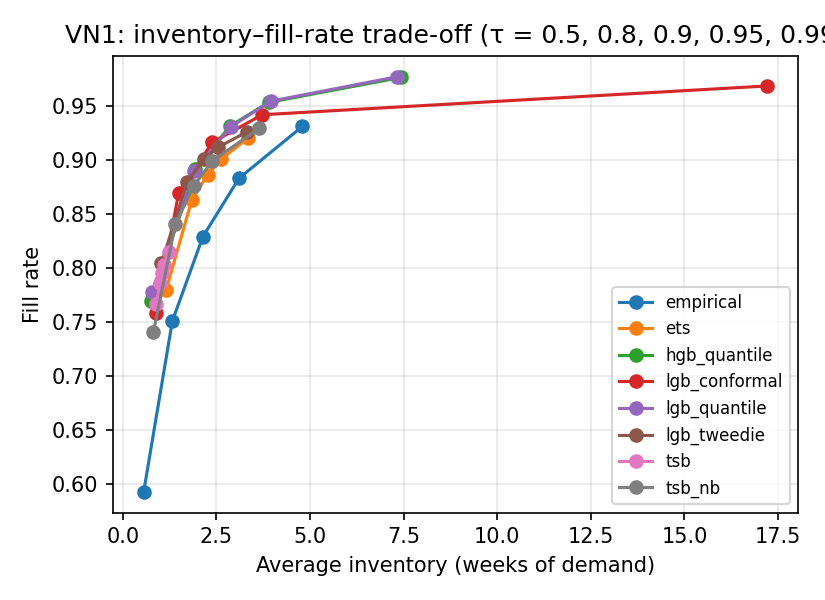

# Cross-dataset results — test window w52_nop (generated by code/analyze_results.py)

## VN1

### Forecast accuracy (all series)

| model         |   horizon |   SQL |   RMSSE |   cov_0.8 |   cov_0.9 |   cov_0.95 |
|:--------------|----------:|------:|--------:|----------:|----------:|-----------:|
| empirical     |         3 | 4.201 |   3.868 |     0.823 |     0.885 |      0.921 |
| empirical     |        13 | 6.265 |   3.497 |     0.76  |     0.818 |      0.842 |
| tsb           |         3 | 3.811 |   2.852 |     0.786 |     0.82  |      0.843 |
| tsb           |        13 | 5.959 |   3.106 |     0.679 |     0.706 |      0.726 |
| tsb_nb        |         3 | 3.496 |   2.878 |     0.817 |     0.88  |      0.916 |
| tsb_nb        |        13 | 5.742 |   3.112 |     0.711 |     0.762 |      0.799 |
| ets           |         3 | 3.241 |   2.699 |     0.845 |     0.888 |      0.912 |
| ets           |        13 | 5.339 |   3.082 |     0.809 |     0.855 |      0.88  |
| lgb_tweedie   |         3 | 2.67  |   2.262 |     0.851 |     0.888 |      0.91  |
| lgb_tweedie   |        13 | 5.026 |   2.844 |     0.819 |     0.857 |      0.879 |
| lgb_conformal |         3 | 2.6   |   2.295 |     0.789 |     0.889 |      0.94  |
| lgb_conformal |        13 | 4.612 |   2.88  |     0.759 |     0.867 |      0.921 |
| hgb_quantile  |         3 | 2.041 |   2.547 |     0.828 |     0.899 |      0.942 |
| hgb_quantile  |        13 | 3.985 |   2.979 |     0.789 |     0.871 |      0.924 |
| lgb_quantile  |         3 | 1.995 |   2.374 |     0.829 |     0.902 |      0.945 |
| lgb_quantile  |        13 | 3.977 |   2.948 |     0.794 |     0.88  |      0.933 |

### SQL by demand class (h = 3)

| model         |   all |   smooth |   erratic |   intermittent |   lumpy |
|:--------------|------:|---------:|----------:|---------------:|--------:|
| empirical     | 4.201 |    0.705 |     0.658 |          8.189 |   1.173 |
| ets           | 3.241 |    0.447 |     0.492 |          6.41  |   0.806 |
| hgb_quantile  | 2.041 |    0.384 |     0.38  |          3.942 |   0.567 |
| lgb_conformal | 2.6   |    0.419 |     0.438 |          5.029 |   0.817 |
| lgb_quantile  | 1.995 |    0.381 |     0.377 |          3.845 |   0.562 |
| lgb_tweedie   | 2.67  |    0.444 |     0.473 |          5.195 |   0.735 |
| tsb           | 3.811 |    0.514 |     0.625 |          7.541 |   0.925 |
| tsb_nb        | 3.496 |    0.438 |     0.514 |          6.98  |   0.78  |

### Inventory KPIs, default scenario, no liquidation (all series)

| model         |   fill_rate |   stockout_rate_demand_weeks |   inventory_weeks |   excess_weeks_of_demand |   fill_rate_lo |   fill_rate_hi |   inventory_weeks_lo |   inventory_weeks_hi |
|:--------------|------------:|-----------------------------:|------------------:|-------------------------:|---------------:|---------------:|---------------------:|---------------------:|
| empirical     |       0.829 |                        0.163 |             2.14  |                    0.406 |          0.808 |          0.843 |                1.974 |                2.343 |
| tsb           |       0.795 |                        0.234 |             1.058 |                    0.145 |          0.78  |          0.809 |                0.959 |                1.2   |
| tsb_nb        |       0.876 |                        0.148 |             1.888 |                    0.232 |          0.86  |          0.888 |                1.748 |                2.05  |
| ets           |       0.886 |                        0.121 |             2.262 |                    0.391 |          0.873 |          0.897 |                2.05  |                2.492 |
| lgb_tweedie   |       0.9   |                        0.109 |             2.158 |                    0.291 |          0.885 |          0.911 |                1.986 |                2.365 |
| lgb_conformal |       0.916 |                        0.098 |             2.393 |                    0.271 |          0.903 |          0.927 |                2.246 |                2.576 |
| hgb_quantile  |       0.931 |                        0.079 |             2.862 |                    0.583 |          0.922 |          0.939 |                2.612 |                3.187 |
| lgb_quantile  |       0.931 |                        0.078 |             2.891 |                    0.598 |          0.923 |          0.938 |                2.634 |                3.223 |

### fill_rate by demand class (default, no liquidation)

| model         |   all |   smooth |   erratic |   intermittent |   lumpy |
|:--------------|------:|---------:|----------:|---------------:|--------:|
| empirical     | 0.829 |    0.89  |     0.811 |          0.564 |   0.665 |
| ets           | 0.886 |    0.933 |     0.864 |          0.662 |   0.804 |
| hgb_quantile  | 0.931 |    0.957 |     0.906 |          0.84  |   0.888 |
| lgb_conformal | 0.916 |    0.951 |     0.882 |          0.789 |   0.86  |
| lgb_quantile  | 0.931 |    0.957 |     0.903 |          0.84  |   0.887 |
| lgb_tweedie   | 0.9   |    0.938 |     0.867 |          0.763 |   0.831 |
| tsb           | 0.795 |    0.859 |     0.724 |          0.605 |   0.674 |
| tsb_nb        | 0.876 |    0.927 |     0.836 |          0.669 |   0.788 |

### inventory_weeks by demand class (default, no liquidation)

| model         |   all |   smooth |   erratic |   intermittent |   lumpy |
|:--------------|------:|---------:|----------:|---------------:|--------:|
| empirical     | 2.14  |    1.72  |     3.267 |          1.355 |   3.513 |
| ets           | 2.262 |    1.491 |     4.028 |          1.548 |   4.785 |
| hgb_quantile  | 2.862 |    2.003 |     4.662 |          2.181 |   5.997 |
| lgb_conformal | 2.393 |    1.71  |     3.729 |          2.222 |   4.721 |
| lgb_quantile  | 2.891 |    2.028 |     4.77  |          2.162 |   5.912 |
| lgb_tweedie   | 2.158 |    1.576 |     3.414 |          1.861 |   3.995 |
| tsb           | 1.058 |    0.718 |     1.775 |          0.822 |   2.257 |
| tsb_nb        | 1.888 |    1.29  |     3.264 |          1.394 |   3.754 |

### Trade-off: fill rate and inventory (weeks) across target service level τ

| model         |   ('fill_rate', 0.5) |   ('fill_rate', 0.8) |   ('fill_rate', 0.9) |   ('fill_rate', 0.95) |   ('fill_rate', 0.99) |   ('inventory_weeks', 0.5) |   ('inventory_weeks', 0.8) |   ('inventory_weeks', 0.9) |   ('inventory_weeks', 0.95) |   ('inventory_weeks', 0.99) |
|:--------------|---------------------:|---------------------:|---------------------:|----------------------:|----------------------:|---------------------------:|---------------------------:|---------------------------:|----------------------------:|----------------------------:|
| empirical     |                0.593 |                0.751 |                0.829 |                 0.883 |                 0.931 |                      0.558 |                      1.323 |                      2.14  |                       3.103 |                       4.798 |
| ets           |                0.779 |                0.862 |                0.886 |                 0.901 |                 0.92  |                      1.153 |                      1.839 |                      2.262 |                       2.629 |                       3.341 |
| hgb_quantile  |                0.769 |                0.891 |                0.931 |                 0.953 |                 0.976 |                      0.755 |                      1.941 |                      2.862 |                       3.892 |                       7.431 |
| lgb_conformal |                0.759 |                0.869 |                0.916 |                 0.941 |                 0.968 |                      0.896 |                      1.49  |                      2.393 |                       3.722 |                      17.197 |
| lgb_quantile  |                0.778 |                0.889 |                0.931 |                 0.954 |                 0.977 |                      0.781 |                      1.89  |                      2.891 |                       3.958 |                       7.324 |
| lgb_tweedie   |                0.804 |                0.879 |                0.9   |                 0.912 |                 0.926 |                      1.028 |                      1.717 |                      2.158 |                       2.552 |                       3.326 |
| tsb           |                0.767 |                0.786 |                0.795 |                 0.803 |                 0.815 |                      0.892 |                      0.997 |                      1.058 |                       1.112 |                       1.221 |
| tsb_nb        |                0.74  |                0.84  |                0.876 |                 0.899 |                 0.929 |                      0.816 |                      1.404 |                      1.888 |                       2.388 |                       3.642 |

### Inventory (weeks of demand) needed to reach a fill rate — all (— = outside the fill range reached for τ ∈ [0.5, 0.99])

|               |   fill 0.90 |   fill 0.92 |   fill 0.94 |   fill 0.96 |   fill 0.98 |
|:--------------|------------:|------------:|------------:|------------:|------------:|
| empirical     |        3.71 |        4.42 |      —    |      —    |         — |
| ets           |        2.62 |      —    |      —    |      —    |         — |
| hgb_quantile  |        2.14 |        2.61 |        3.29 |        4.99 |         — |
| lgb_conformal |        2.08 |        2.6  |        3.65 |       13.12 |         — |
| lgb_quantile  |        2.15 |        2.63 |        3.32 |        4.85 |         — |
| lgb_tweedie   |        2.15 |        3.01 |      —    |      —    |         — |
| tsb           |      —    |      —    |      —    |      —    |         — |
| tsb_nb        |        2.44 |        3.27 |      —    |      —    |         — |

### Inventory (weeks of demand) needed to reach a fill rate — smooth (— = outside the fill range reached for τ ∈ [0.5, 0.99])

|               |   fill 0.90 |   fill 0.92 |   fill 0.94 |   fill 0.96 |   fill 0.98 |
|:--------------|------------:|------------:|------------:|------------:|------------:|
| empirical     |        1.87 |        2.18 |        2.7  |      —    |      —    |
| ets           |        1.11 |        1.29 |        1.63 |        2.25 |      —    |
| hgb_quantile  |        1.19 |        1.34 |        1.7  |        2.14 |        3.48 |
| lgb_conformal |        1.04 |        1.21 |        1.53 |        2.1  |        4.03 |
| lgb_quantile  |        1.16 |        1.32 |        1.7  |        2.15 |        3.39 |
| lgb_tweedie   |        1.11 |        1.28 |        1.63 |        2.38 |      —    |
| tsb           |      —    |      —    |      —    |      —    |      —    |
| tsb_nb        |        0.97 |        1.21 |        1.55 |        2.21 |      —    |

### Inventory (weeks of demand) needed to reach a fill rate — erratic (— = outside the fill range reached for τ ∈ [0.5, 0.99])

|               |   fill 0.90 |   fill 0.92 |   fill 0.94 |   fill 0.96 |   fill 0.98 |
|:--------------|------------:|------------:|------------:|------------:|------------:|
| empirical     |        6.39 |        7.59 |        8.79 |      —    |         — |
| ets           |        5.18 |      —    |      —    |      —    |         — |
| hgb_quantile  |        4.49 |        5.55 |        7.38 |       10.51 |         — |
| lgb_conformal |        4.56 |        5.49 |        8.87 |       12.48 |         — |
| lgb_quantile  |        4.66 |        5.64 |        7.02 |       10.02 |         — |
| lgb_tweedie   |      —    |      —    |      —    |      —    |         — |
| tsb           |      —    |      —    |      —    |      —    |         — |
| tsb_nb        |        5.53 |        6.54 |      —    |      —    |         — |

### Inventory (weeks of demand) needed to reach a fill rate — intermittent (— = outside the fill range reached for τ ∈ [0.5, 0.99])

|               |   fill 0.90 |   fill 0.92 |   fill 0.94 |   fill 0.96 |   fill 0.98 |
|:--------------|------------:|------------:|------------:|------------:|------------:|
| empirical     |         — |         — |         — |         — |         — |
| ets           |         — |         — |         — |         — |         — |
| hgb_quantile  |         — |         — |         — |         — |         — |
| lgb_conformal |         — |         — |         — |         — |         — |
| lgb_quantile  |         — |         — |         — |         — |         — |
| lgb_tweedie   |         — |         — |         — |         — |         — |
| tsb           |         — |         — |         — |         — |         — |
| tsb_nb        |         — |         — |         — |         — |         — |

### Inventory (weeks of demand) needed to reach a fill rate — lumpy (— = outside the fill range reached for τ ∈ [0.5, 0.99])

|               |   fill 0.90 |   fill 0.92 |   fill 0.94 |   fill 0.96 |   fill 0.98 |
|:--------------|------------:|------------:|------------:|------------:|------------:|
| empirical     |      —    |      —    |      —    |      —    |         — |
| ets           |      —    |      —    |      —    |      —    |         — |
| hgb_quantile  |        6.76 |        8.24 |       11.98 |      —    |         — |
| lgb_conformal |        8.27 |       37.16 |       72.4  |      107.63 |         — |
| lgb_quantile  |        6.74 |        8.08 |       11.5  |      —    |         — |
| lgb_tweedie   |      —    |      —    |      —    |      —    |         — |
| tsb           |      —    |      —    |      —    |      —    |         — |
| tsb_nb        |      —    |      —    |      —    |      —    |         — |

### Frontier rank (mean rank of inventory needed over the fill targets; 1 = least inventory; a model that cannot reach a target shares the last ranks)

|               |   all |   smooth |   erratic |   intermittent |   lumpy |
|:--------------|------:|---------:|----------:|---------------:|--------:|
| empirical     |  6.25 |      6.9 |      5    |            nan |       6 |
| ets           |  6.38 |      4.4 |      5.88 |            nan |       6 |
| hgb_quantile  |  1.75 |      4.4 |      1.75 |            nan |       2 |
| lgb_conformal |  2    |      1.8 |      2.5  |            nan |       3 |
| lgb_quantile  |  2.25 |      3.8 |      2    |            nan |       1 |
| lgb_tweedie   |  5    |      4.4 |      6.75 |            nan |       6 |
| tsb           |  6.88 |      7.5 |      6.75 |            nan |       6 |
| tsb_nb        |  5.5  |      2.8 |      5.38 |            nan |       6 |

### Liquidation policies, default scenario (all series)

| model         | policy   |   fill_rate |   stockout_rate_demand_weeks |   inventory_weeks |   excess_weeks_of_demand |   liquidated_share |   liq_series_share |
|:--------------|:---------|------------:|-----------------------------:|------------------:|-------------------------:|-------------------:|-------------------:|
| empirical     | none     |      0.829  |                       0.1628 |            2.1399 |                   0.4061 |             0      |             0      |
| empirical     | quantile |      0.8289 |                       0.163  |            2.1363 |                   0.405  |             0.0005 |             0.013  |
| empirical     | fixed    |      0.8274 |                       0.1739 |            1.9136 |                   0.2214 |             0.0513 |             0.2547 |
| empirical     | dead13   |      0.828  |                       0.1771 |            1.9523 |                   0.2396 |             0.0052 |             0.1381 |
| empirical     | dead26   |      0.8286 |                       0.1682 |            2.0243 |                   0.3313 |             0.0049 |             0.0773 |
| tsb           | none     |      0.7954 |                       0.2344 |            1.0585 |                   0.1449 |             0      |             0      |
| tsb           | quantile |      0.7946 |                       0.2394 |            0.9412 |                   0.1342 |             0.016  |             0.1901 |
| tsb           | fixed    |      0.7952 |                       0.2375 |            1.0519 |                   0.1424 |             0.0013 |             0.1276 |
| tsb           | dead13   |      0.7951 |                       0.2422 |            1.045  |                   0.1409 |             0.0019 |             0.1438 |
| tsb           | dead26   |      0.7954 |                       0.2356 |            1.0564 |                   0.1442 |             0.0002 |             0.055  |
| tsb_nb        | none     |      0.8756 |                       0.1479 |            1.8881 |                   0.2318 |             0      |             0      |
| tsb_nb        | quantile |      0.8752 |                       0.1518 |            1.8245 |                   0.2242 |             0.0106 |             0.1469 |
| tsb_nb        | fixed    |      0.8749 |                       0.152  |            1.8743 |                   0.2266 |             0.0028 |             0.1361 |
| tsb_nb        | dead13   |      0.8752 |                       0.1556 |            1.8716 |                   0.2277 |             0.0025 |             0.14   |
| tsb_nb        | dead26   |      0.8756 |                       0.1489 |            1.8865 |                   0.2313 |             0.0002 |             0.0469 |
| ets           | none     |      0.8861 |                       0.1205 |            2.2623 |                   0.3912 |             0      |             0      |
| ets           | quantile |      0.886  |                       0.1208 |            2.2542 |                   0.3868 |             0.0006 |             0.0181 |
| ets           | fixed    |      0.8844 |                       0.1317 |            2.162  |                   0.3162 |             0.0273 |             0.3564 |
| ets           | dead13   |      0.8853 |                       0.1355 |            2.1741 |                   0.3203 |             0.0037 |             0.1449 |
| ets           | dead26   |      0.8858 |                       0.1267 |            2.2073 |                   0.3492 |             0.0018 |             0.0895 |
| lgb_tweedie   | none     |      0.9003 |                       0.1095 |            2.1581 |                   0.2911 |             0      |             0      |
| lgb_tweedie   | quantile |      0.9001 |                       0.1097 |            2.1214 |                   0.2656 |             0.004  |             0.025  |
| lgb_tweedie   | fixed    |      0.8977 |                       0.1183 |            2.1071 |                   0.2629 |             0.0123 |             0.3592 |
| lgb_tweedie   | dead13   |      0.8996 |                       0.1236 |            2.0995 |                   0.2516 |             0.0037 |             0.145  |
| lgb_tweedie   | dead26   |      0.9002 |                       0.1147 |            2.1331 |                   0.2777 |             0.0014 |             0.0897 |
| lgb_conformal | none     |      0.916  |                       0.0979 |            2.3928 |                   0.2712 |             0      |             0      |
| lgb_conformal | quantile |      0.916  |                       0.0981 |            2.3814 |                   0.2659 |             0.0009 |             0.0194 |
| lgb_conformal | fixed    |      0.9125 |                       0.1081 |            2.3234 |                   0.2282 |             0.0156 |             0.3572 |
| lgb_conformal | dead13   |      0.9153 |                       0.1119 |            2.324  |                   0.2226 |             0.0036 |             0.1449 |
| lgb_conformal | dead26   |      0.9158 |                       0.1035 |            2.3576 |                   0.2511 |             0.0017 |             0.0898 |
| hgb_quantile  | none     |      0.9309 |                       0.0789 |            2.8615 |                   0.5834 |             0      |             0      |
| hgb_quantile  | quantile |      0.9299 |                       0.0797 |            2.4801 |                   0.4311 |             0.0303 |             0.0825 |
| hgb_quantile  | fixed    |      0.9243 |                       0.0934 |            2.7218 |                   0.5015 |             0.0206 |             0.4561 |
| hgb_quantile  | dead13   |      0.9302 |                       0.0933 |            2.8036 |                   0.5482 |             0.0045 |             0.1452 |
| hgb_quantile  | dead26   |      0.9307 |                       0.0843 |            2.8369 |                   0.5693 |             0.0013 |             0.0905 |
| lgb_quantile  | none     |      0.9306 |                       0.0776 |            2.8915 |                   0.5981 |             0      |             0      |
| lgb_quantile  | quantile |      0.9303 |                       0.078  |            2.5756 |                   0.4921 |             0.0254 |             0.0659 |
| lgb_quantile  | fixed    |      0.9235 |                       0.0916 |            2.7597 |                   0.523  |             0.0201 |             0.4532 |
| lgb_quantile  | dead13   |      0.9299 |                       0.0917 |            2.8306 |                   0.5593 |             0.0046 |             0.1452 |
| lgb_quantile  | dead26   |      0.9304 |                       0.0828 |            2.8659 |                   0.5839 |             0.0014 |             0.0902 |
